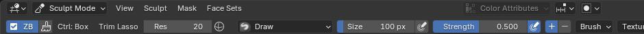

# Установка ZB_2Blender

ZB_2Blender — один файл аддона `Bl_2_zbr_sclpt.py`. Устанавливать Python или дополнительные программы не нужно.

Инструкция использует английские названия интерфейса Blender, пояснения даны по-русски. Нужен **Blender 5.2**: аддон проверен на 5.2.2 и 5.2.3, более старые версии не поддерживаются.

## 1. Проверьте версию Blender

Откройте **Help → About Blender** («Справка → О Blender»). Если номер версии меньше 5.2, сначала установите Blender 5.2 с [официального сайта](https://www.blender.org/download/).

## 2. Скачайте файл аддона

1. Откройте [ссылку на Bl_2_zbr_sclpt.py](https://github.com/Ddosena/ZB_2Blender/releases/latest/download/Bl_2_zbr_sclpt.py). Она всегда ведёт на последнюю версию. Аккаунт GitHub не нужен.
2. Дождитесь окончания загрузки. Обычно файл попадает в папку «Загрузки».
3. Ничего в файле не меняйте и не переименовывайте его.

Файл есть и на [странице выпусков](https://github.com/Ddosena/ZB_2Blender/releases/latest): разверните **Assets** и выберите **Bl_2_zbr_sclpt.py**. **Source code (zip)** и **Code → Download ZIP** не подходят: это архивы всего репозитория, а не файл для установки.

Если браузер показал текст программы вместо загрузки, нажмите на ссылку правой кнопкой и выберите **«Сохранить ссылку как…»**.

## 3. Установите файл в Blender

1. В верхнем меню Blender нажмите **Edit → Preferences…** («Правка → Настройки»). Откроется окно настроек.
2. Слева выберите **Add-ons** («Дополнения»).
3. В правом верхнем углу раздела нажмите маленькую кнопку со стрелкой вниз **⌄**.
4. Выберите **Install from Disk…** («Установить с диска»).
5. Перейдите в папку с файлом, например «Загрузки», и один раз нажмите на **Bl_2_zbr_sclpt.py**.
6. Нажмите кнопку **Install from Disk** в файловом окне.
7. Введите в поиске раздела Add-ons **Bl_2_zbr_sclpt**. Если стоит фильтр **Enabled Add-ons Only**, временно снимите его.
8. Убедитесь, что у **Bl_2_zbr_sclpt** стоит **галочка**. Обычно Blender включает аддон сразу; если галочки нет, поставьте её.
9. Закройте окно Preferences. Настройки Blender сохраняются сами.

При первом включении аддон сам создаёт копии кистей Essentials с Size Pressure и подключает их библиотеку. Других файлов скачивать не нужно.

## 4. Проверьте, что всё работает

1. Выберите меш, например стартовый куб, и перейдите в **Sculpt Mode** (меню режима в левом верхнем углу 3D-вида).
2. В начале шапки инструментов должна появиться кнопка **ZB** с галочкой, рядом — выбор Ctrl-фигуры, инструмент Ctrl+Shift и поле **Res** (плотность DynaMesh):

   

3. Наведите мышь на 3D-вид и нажмите <kbd>N</kbd>. Справа откроется боковая панель. Выберите вертикальную вкладку **ZBrush**: в ней все настройки аддона.

   

4. Внизу слева видна плитка текущей кисти. Нажмите <kbd>3</kbd> — выберется Grab (Move), <kbd>Q</kbd> — вернётся обычная кисть.

Если кнопки ZB нет, проверьте галочку в Add-ons и версию Blender, затем перезапустите Blender. Другие решения — в [FAQ](FAQ_RU.md). Как пользоваться — в [инструкции](USAGE_RU.md).

## Обновление

1. Сохраните сцену (**File → Save**).
2. Скачайте новый **Bl_2_zbr_sclpt.py** по той же [ссылке](https://github.com/Ddosena/ZB_2Blender/releases/latest/download/Bl_2_zbr_sclpt.py). Что изменилось — в [списке изменений](../CHANGELOG.md).
3. Установите его так же: **Edit → Preferences → Add-ons → ⌄ → Install from Disk…**. Новый файл заменит старый.
4. **Перезапустите Blender**: уже открытый Blender держит в памяти прежнюю версию аддона.

## Выключение и удаление

- **На время:** кнопка **ZB** в шапке Sculpt или <kbd>Ctrl</kbd>+<kbd>Shift</kbd>+<kbd>Alt</kbd>+<kbd>Z</kbd>. Клавиши и жесты сразу становятся обычными. Blender запоминает это состояние, поэтому ZB включается обратно той же кнопкой.
- **Выключить:** **Edit → Preferences → Add-ons**, снимите галочку у **Bl_2_zbr_sclpt**. Раскладка вернётся к стандартной, библиотека кистей аддона отключится.
- **Удалить:** там же раскройте строку **Bl_2_zbr_sclpt** треугольником слева от названия и нажмите **Uninstall** справа. Скачанный файл в папке «Загрузки» можно оставить для повторной установки.
