# Как пользоваться ZB_2Blender

Аддон работает только в **Sculpt Mode**. В Object Mode и других режимах Blender остаётся обычным. Названия интерфейса Blender даны по-английски.

**Содержание:** [Включить и выключить](#включить-и-выключить) · [Навигация](#навигация) · [Клавиши](#клавиши) · [Grab как Move и BackfaceMask](#grab-как-move-и-backfacemask) · [Маска (Ctrl)](#маска-ctrl) · [Видимость и обрезка (Ctrl+Shift)](#видимость-и-обрезка-ctrlshift) · [DynaMesh](#dynamesh) · [Гизмо (W / E)](#гизмо-w--e) · [Сабтулы](#сабтулы) · [Полигруппы](#полигруппы) · [Примитив вместо меша](#примитив-вместо-меша) · [Отмена](#отмена) · [Чем отличается от ZBrush](#чем-отличается-от-zbrush)

## Включить и выключить

- Кнопка **ZB** в начале шапки инструментов или <kbd>Ctrl</kbd>+<kbd>Shift</kbd>+<kbd>Alt</kbd>+<kbd>Z</kbd> мгновенно включает и выключает управление ZBrush. Состояние запоминается.
- Боковая панель <kbd>N</kbd> → вкладка **ZBrush** — все настройки аддона: DynaMesh (Resolution, Voxel Size, Remesh), BackfaceMask текущей кисти, «Отделить замаскированное», Del Hidden, замена примитивом, кнопки гизмо, полигруппы, «Затемнять другие объекты», «Навигация», «Ctrl по пустому месту».

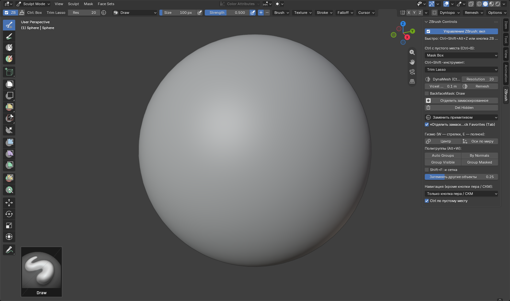

## Навигация

**По умолчанию ЛКМ не вращает вид**: им рисуют кистью. Вид вращается колесом мыши (СКМ) или нижней кнопкой пера. Чтобы вращать ЛКМ по пустому месту, как в ZBrush, выберите вариант в настройке **«Навигация»** (панель N → ZBrush или Preferences аддона):

- **Только кнопка пера / СКМ** — по умолчанию;
- **ЛКМ по фону** — как в ZBrush, жесты в таблице ниже;
- **ПКМ где угодно** — вращение правой кнопкой и над мешем, вместо контекстного меню;
- **ЛКМ по фону и ПКМ** — оба варианта.

| Жест | Действие |
| --- | --- |
| СКМ (колесо мыши) / нижняя кнопка пера | вращение, штатное Blender, со всеми настройками **Preferences → Navigation** |
| <kbd>Shift</kbd> во время вращения | прилипание к углам 90°, как в ZBrush |
| <kbd>Shift</kbd>+СКМ | вращение с прилипанием к осям |
| <kbd>Alt</kbd>+СКМ / <kbd>Ctrl</kbd>+СКМ | сдвиг / зум |
| <kbd>F</kbd> | показать модель целиком |
| быстрый двойной <kbd>Alt</kbd>+клик по другому объекту | перейти на него, как выбрать сабтул |

С включённой навигацией **ЛКМ по фону**:

| Жест | Действие |
| --- | --- |
| протяжка по пустому месту | вращение |
| <kbd>Shift</kbd>+клик, отпустить Shift, тянуть | крен |
| <kbd>Alt</kbd>+протяжка по пустому месту | сдвиг |
| <kbd>Alt</kbd>+клик, отпустить Alt, тянуть | зум |

Жесты сверены с [документацией Maxon: Navigation](https://help.maxon.net/zbr/en-us/Content/html/user-guide/customizing-zbrush/navigation/navigation.html).

## Клавиши

| Клавиша | Действие |
| --- | --- |
| <kbd>Q</kbd> | кисть (Draw) |
| <kbd>W</kbd> / <kbd>E</kbd> | гизмо со стрелками / полное гизмо: стрелки, кольца, масштаб. См. [Гизмо](#гизмо-w--e) |
| <kbd>G</kbd> / <kbd>R</kbd> / <kbd>S</kbd> | перемещение / поворот / масштаб незамаскированной части, как в Object Mode. <kbd>X</kbd> <kbd>Y</kbd> <kbd>Z</kbd> — по осям гизмо, даже повёрнутым; можно ввести число. ЛКМ или Enter подтверждают, Esc или ПКМ отменяют. Центр — центр гизмо, а если гизмо ещё не ставили — центр незамаскированного. У <kbd>S</kbd>: <kbd>Shift</kbd>+ось — масштаб в плоскости, <kbd>Ctrl</kbd> — шаг 0,1, <kbd>Shift</kbd> — точная настройка |
| держать <kbd>Пробел</kbd>, вести, отпустить | размер кисти |
| <kbd>U</kbd> / <kbd>O</kbd> | сила / жёсткость края кисти |
| <kbd>L</kbd> | Lazy Mouse |
| <kbd>X</kbd> | симметрия вкл / выкл. Включается с теми осями, что были до выключения; оси Y и Z выбираются кнопками в шапке |
| <kbd>B</kbd> | полка кистей |
| <kbd>1</kbd> <kbd>2</kbd> <kbd>3</kbd> <kbd>4</kbd> | Crease Sharp, Scrape/Fill, Grab (Move), Clay Strips; также <kbd>V</kbd> Draw, <kbd>C</kbd> Clay Strips, <kbd>Shift</kbd>+<kbd>T</kbd> Scrape/Fill. У всех включена Size Pressure |
| <kbd>Alt</kbd>+мазок / <kbd>Shift</kbd>+мазок | инверсия кисти / сглаживание |
| <kbd>Tab</kbd> | Quick Favorites и под ними: Symmetrize в одну или другую сторону, BackfaceMask текущей кисти, Del Hidden, «Отделить замаскированное» |
| <kbd>Shift</kbd>+<kbd>F</kbd> | цвета полигрупп. Сетку активного объекта добавляет галочка «Shift+F: и сетка» в панели N |
| <kbd>D</kbd> / <kbd>Shift</kbd>+<kbd>D</kbd> / <kbd>Ctrl</kbd>+<kbd>D</kbd> | уровень Multires выше / ниже / подразделить. Работает, только если модификатор Multires уже добавлен; сам аддон Multires не добавляет |
| <kbd>Ctrl</kbd>+<kbd>R</kbd> | размер вокселя DynaMesh: ведёте перо — квадрат показывает сетку вокселей, клик — запомнить |
| <kbd>Shift</kbd>+<kbd>A</kbd> | добавить примитив, отделить замаскированное, Merge Down. См. [Сабтулы](#сабтулы) |

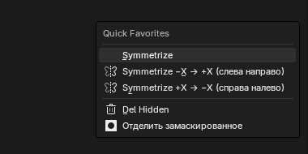

В Sculpt Mode меню Stroke Method на <kbd>E</kbd> и Quick Favorites на <kbd>Q</kbd> заменены клавишами аддона, а штатные <kbd>Ctrl</kbd>+<kbd>0</kbd>…<kbd>5</kbd> (они молча добавляли Multires) отключены.

## Grab как Move и BackfaceMask

- **Grab (клавиша 3) работает как Move в ZBrush.** Он тянет сферу радиуса кисти вокруг точки нажатия. Если перо чуть мимо меша, но меш попадает в круг кисти, Grab цепляет ближайшее место. Учитываются кривая спада, Hardness и сила кисти, маска, скрытые части и симметрия. Протяжка отменяется одним <kbd>Ctrl</kbd>+<kbd>Z</kbd>.
- С навигацией **ЛКМ по фону** протяжка по пустому месту вращает вид, а над мешем работает Grab.
- С Dyntopo, Multires, Shape Keys и деформирующими модификаторами работает штатный Grab Blender.
- **BackfaceMask** (галочка кисти Blender *Front Faces Only*) — в меню <kbd>Tab</kbd> и в панели N. У обычных кистей она не даёт задеть обратную сторону тонких мест: губ, век, ушей. **У Grab она работает по направлению протяжки**: двигается то, что смотрит туда, куда вы тянете. Например, у плоской пластины, которую видно сбоку, при протяжке вниз едет нижняя сторона, а верхняя стоит, и пластина становится толще.

## Маска (Ctrl)

| Жест | Действие |
| --- | --- |
| <kbd>Ctrl</kbd>+протяжка по мешу | кисть маски; если выбран **Mask Lasso** — лассо |
| <kbd>Ctrl</kbd>+протяжка с пустого места | рамка маски с крестиком в центре |
| … нажать <kbd>Alt</kbd> во время протяжки | рамка стирает маску (красная) |
| … держать <kbd>Пробел</kbd> во время протяжки | двигать рамку или лассо целиком |
| <kbd>Ctrl</kbd>+<kbd>Alt</kbd>+протяжка | стереть маску кистью или рамкой |
| пустая рамка (не задела меш) | есть маска — снять маску; маски нет — DynaMesh |
| <kbd>Ctrl</kbd>+клик по мешу / <kbd>Ctrl</kbd>+<kbd>Alt</kbd>+клик | размыть / сделать резче край маски |
| <kbd>Ctrl</kbd>+клик по пустому месту | инверсия маски |
| <kbd>Ctrl</kbd>+<kbd>A</kbd> / <kbd>Ctrl</kbd>+<kbd>I</kbd> / <kbd>Ctrl</kbd>+<kbd>H</kbd> | замаскировать всё / инверсия / показать-скрыть маску |
| <kbd>Ctrl</kbd>+<kbd>W</kbd> | полигруппа из маски; без маски — из видимой части |
| <kbd>Ctrl</kbd>+<kbd>B</kbd> | пирог: рамка (Mask Box), лассо (Mask Lasso) или линия (Mask Line) с пустого места |

| | |
| --- | --- |
| 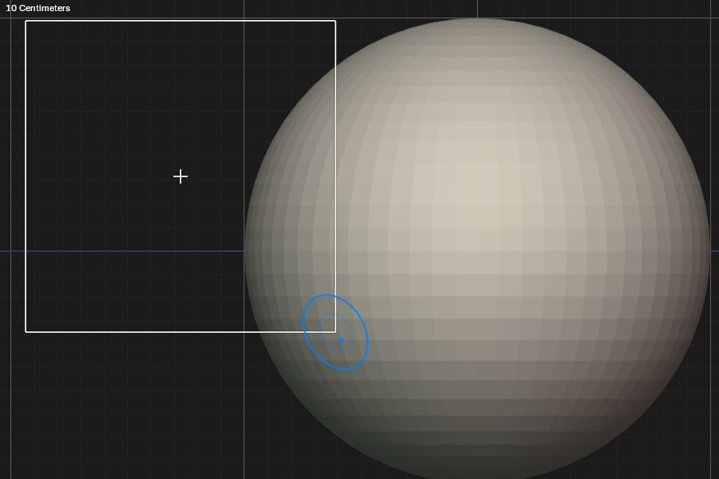 | 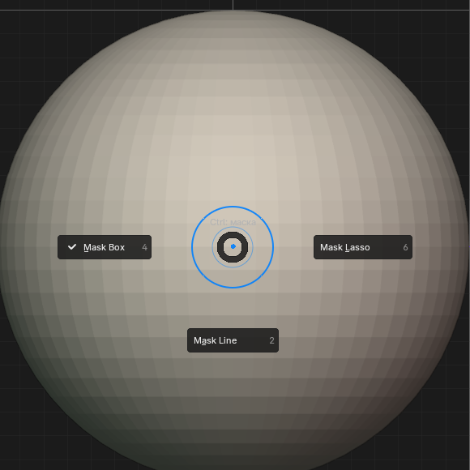 |
| Рамка с крестиком: по нему удобно мерить пропорции | Пирог <kbd>Ctrl</kbd>+<kbd>B</kbd> |

Каждый <kbd>Ctrl</kbd>+клик для размытия расширяет переход маски только на одно кольцо вершин. На плотном меше это малозаметно; кликните несколько раз.

## Видимость и обрезка (Ctrl+Shift)

| Жест | Действие |
| --- | --- |
| <kbd>Ctrl</kbd>+<kbd>Shift</kbd>+протяжка | выбранный инструмент; по умолчанию Trim Lasso |
| <kbd>Ctrl</kbd>+<kbd>Shift</kbd>+нижняя кнопка пера | пирог выбора инструмента |
| <kbd>Ctrl</kbd>+<kbd>Shift</kbd>+протяжка по пустому месту | инверсия видимости |
| <kbd>Ctrl</kbd>+<kbd>Shift</kbd>+<kbd>Alt</kbd>+протяжка | скрыть то, что внутри |
| <kbd>Ctrl</kbd>+<kbd>Shift</kbd>+клик по полигруппе | изолировать её; повторно — скрыть её |
| <kbd>Ctrl</kbd>+<kbd>Shift</kbd>+клик по пустому месту | показать всё |
| <kbd>Ctrl</kbd>+<kbd>Shift</kbd>+<kbd>Alt</kbd>+клик | инверсия видимости |
| **Del Hidden** (<kbd>Tab</kbd>, панель N) | удалить скрытое, как в ZBrush. Не работает с Multires, Shape Keys и Dyntopo |

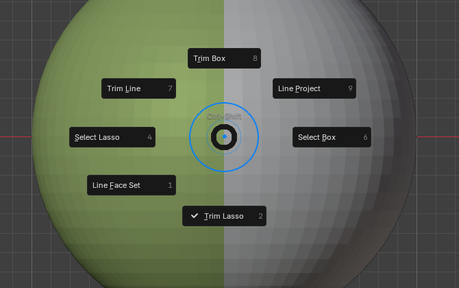

## DynaMesh

- **Ремеш:** пустая <kbd>Ctrl</kbd>-рамка по фону у объекта без маски или кнопка **Remesh** в панели N.
- **Плотность:** поле **Res** в шапке — вокселей по наибольшей стороне объекта, как Resolution в ZBrush: больше — плотнее. Это то же значение, что Voxel Size в метрах в панели N. <kbd>Ctrl</kbd>+<kbd>R</kbd> показывает размер вокселя квадратом сетки прямо на модели.
- Перед ремешем аддон закрывает простые отверстия и проверяет результат. Если ремеш испортил бы модель, исходник остаётся. Сетка в полмиллиона граней обрабатывается несколько секунд.

## Гизмо (W / E)

<kbd>W</kbd> — гизмо со стрелками, <kbd>E</kbd> — полное: стрелки, кольца, квадратики масштаба. Гизмо сразу встаёт в центр незамаскированной части и двигает, вращает и масштабирует только её. Над гизмо — ряд иконок.

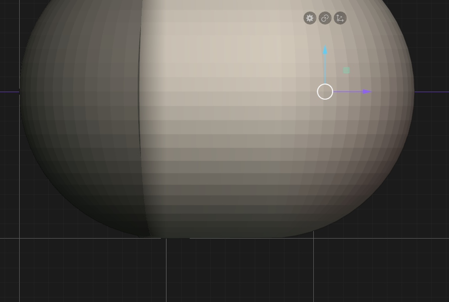

Иконки: ⚙ — замена примитивом, центр — гизмо в центр незамаскированного, оси по миру — сбросить поворот осей.

| Жест (в режиме гизмо) | Действие |
| --- | --- |
| протяжка стрелки / кольца / квадратика | перемещение по оси / поворот / масштаб. После поворота кольцом оси гизмо поворачиваются вместе с мешем |
| протяжка квадратика масштаба (<kbd>E</kbd>) | масштаб точно вдоль оси гизмо, даже повёрнутой; <kbd>Ctrl</kbd> — шаг 0,1, <kbd>Shift</kbd> — точно |
| <kbd>Alt</kbd>+протяжка за стрелку | гизмо едет по оси **без меша** |
| <kbd>Alt</kbd>+протяжка за центр | гизмо свободно в плоскости экрана, без меша |
| <kbd>Alt</kbd>+протяжка за кольцо | повернуть оси гизмо без меша |
| <kbd>Alt</kbd>+клик / <kbd>Alt</kbd>+протяжка по мешу | центр гизмо в точку на поверхности, синяя ось Z — по нормали поверхности |
| <kbd>Alt</kbd>+клик по пустому месту | центр гизмо обратно в центр незамаскированного |
| <kbd>Ctrl</kbd>+протяжка стрелки или центра | **копия** незамаскированного, если это отдельный кусок, или **выдавливание**, если это участок целого меша. Старое маскируется, новое едет за пером и получает свою полигруппу. Копия делается, только пока зажат Ctrl |
| <kbd>Ctrl</kbd>+клик по полигруппе | замаскировать всё, кроме неё, и поставить гизмо в её центр |
| <kbd>Shift</kbd>+ПКМ по мешу | центр гизмо в точку на поверхности (штатно) |

| | |
| --- | --- |
| 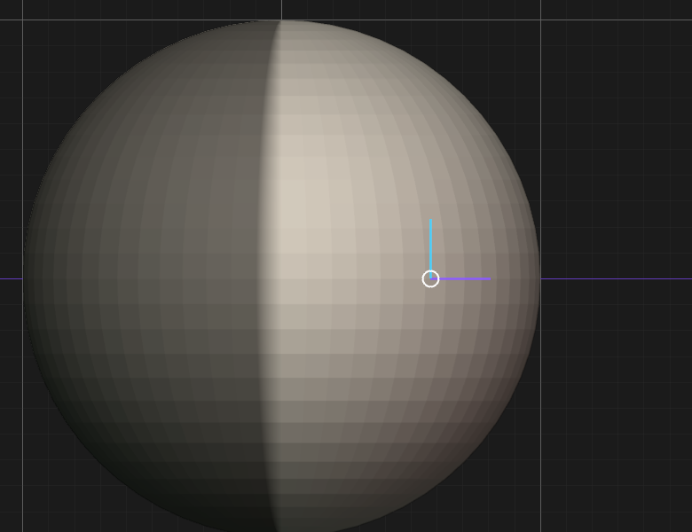 | 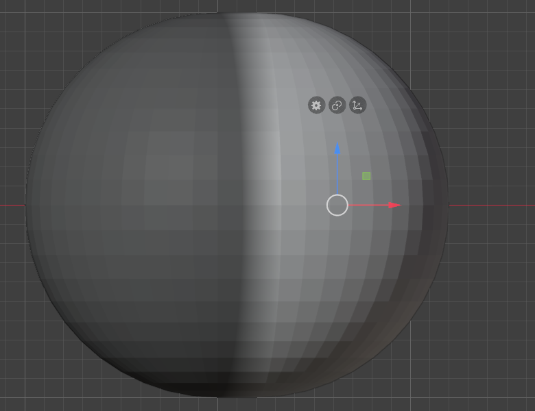 |
| <kbd>Alt</kbd> за стрелку: пока тянете, виден «призрак» — туда гизмо переедет, когда отпустите перо | <kbd>Ctrl</kbd> за стрелку X: незамаскированная половина выдавлена, старое замаскировано |

- Все Ctrl-жесты маски работают и в режиме гизмо; только по мешу вместо кисти маски тянется рамка.
- Оси гизмо запоминаются вместе с историей: <kbd>Ctrl</kbd>+<kbd>Z</kbd> возвращает и оси.
- После замены примитивом, добавления примитива, отделения, Del Hidden, Merge Down и ремеша центр гизмо сам встаёт в центр незамаскированного.
- Симметрия перенос копии не зеркалит.

## Сабтулы

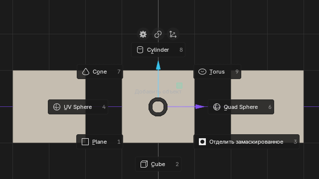

| Действие | Что происходит |
| --- | --- |
| <kbd>Shift</kbd>+<kbd>A</kbd> → примитив | новый объект в центре гизмо, размером в четверть текущего объекта. Сразу активен в Sculpt Mode |
| «Отделить замаскированное» (<kbd>Shift</kbd>+<kbd>A</kbd>, <kbd>Tab</kbd>, панель N) | замаскированная часть уходит в новый объект «Имя.masked», разрез закрывается у обеих частей, если сетка это позволяет |
| <kbd>Shift</kbd>+<kbd>A</kbd> → Merge Down | объединить с мешем, который стоит ниже по имени в той же коллекции; имя цели показано в меню |
| быстрый двойной <kbd>Alt</kbd>+клик по объекту | перейти на него |

В Sculpt объект, который вы скульптите, виден как обычно, а остальные чуть темнее. Сила затемнения — ползунок «Затемнять другие объекты» в панели N, 0 — не затемнять.

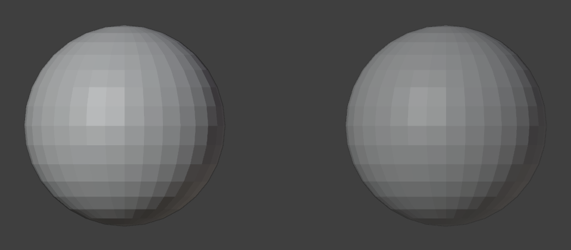

## Полигруппы

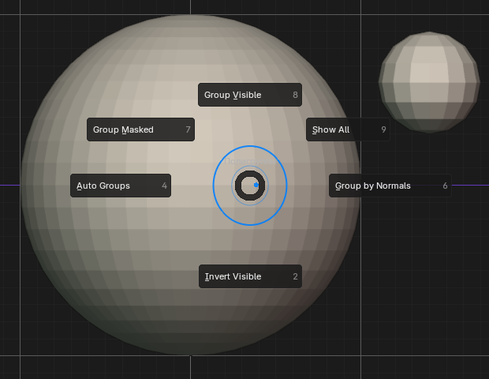

Пирог <kbd>Alt</kbd>+<kbd>W</kbd>: Auto Groups, Group by Normals, Invert Visible, Group Visible, Group Masked, Show All. Те же кнопки — в панели N. Порог Group by Normals — в панели последней операции (<kbd>F9</kbd>, Threshold).

Полигруппу с номером 1 Blender всегда рисует без цвета, белой. Чтобы раскрасить белую часть: <kbd>Ctrl</kbd>+<kbd>Shift</kbd>+клик по ней (оставить только её), <kbd>Ctrl</kbd>+<kbd>W</kbd> (новая группа видимого), <kbd>Ctrl</kbd>+<kbd>Shift</kbd>+клик по пустому месту (показать всё).

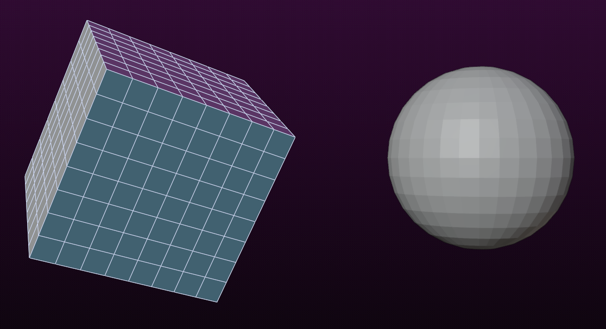

## Примитив вместо меша

Иконка ⚙ над гизмо, кнопка со сферой в шапке или панель N → окно: примитив, размер, число сегментов → OK.

- **С маской:** замаскированное остаётся, незамаскированное заменяется одним примитивом ровных пропорций в центре гизмо, размером с самый крупный незамаскированный кусок.
- **Без маски:** заменяется весь меш.
- Размер «По габаритам» растягивает примитив по габаритам заменяемого, «Стандартный» — радиус 1.
- Объект с Multires или Shape Keys не заменяется.

## Отмена

<kbd>Ctrl</kbd>+<kbd>Z</kbd> / <kbd>Ctrl</kbd>+<kbd>Shift</kbd>+<kbd>Z</kbd> в Sculpt **никогда не выводят в Object Mode**. Действия аддона, которым нужен Object Mode (<kbd>Shift</kbd>+<kbd>A</kbd>, отделение, Del Hidden, ⚙, Merge Down, копия гизмо), отменяются и повторяются одним нажатием. Симметрию отмена не меняет. В начале сеанса Sculpt <kbd>Ctrl</kbd>+<kbd>Z</kbd> ничего не делает и пишет подсказку в строке состояния; в Object Mode можно выйти через меню режима.

## Чем отличается от ZBrush

- Мазок маски начинается с протяжки, а не с нажатия: <kbd>Ctrl</kbd>+клик занят размытием.
- Alt-перенос гизмо срабатывает, когда отпускаете перо; во время протяжки виден призрак.
- Центр незамаскированного — среднее вершин с весом «1 − маска», как считает Blender; в ZBrush — центр габаритов.
- Нет деформеров гизмо (Bend, Twist, FFD), Lock, Sticky, Mesh to Axis, отрицательной копии (Ctrl+Alt), Polyline Mask.
- Пробел — размер кисти, а не QuickMenu. <kbd>S</kbd> — масштаб, как в Object Mode, а не размер кисти; <kbd>R</kbd> — поворот.
- Другой объект выбирается двойным <kbd>Alt</kbd>+кликом, а не одиночным: так его не перепутать с инверсией кисти.
- Symmetrize и Del Hidden стоят в меню <kbd>Tab</kbd> под Quick Favorites, а не внутри: добавить пункт в Quick Favorites из аддона Blender не позволяет. Можно добавить вручную: правый щелчок по пункту → Add to Quick Favorites.
